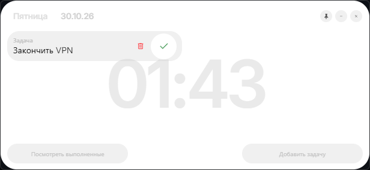

# Taskglass

Компактный виджет задач для рабочего стола на **Tauri 2 + Vanilla TypeScript + Vite**.

Прозрачное окно без системной рамки, всегда под рукой: список задач, часы, минимальный интерфейс.



## Возможности

- Добавление, редактирование (клик по названию), удаление и переключение задач
- Drag-and-drop: перетаскивание карточек меняет порядок
- Список выполненных задач отдельно; при >5 активных — карточка «Открыть полный список задач»
- Локальное сохранение задач в `localStorage`
- Окно перетаскивается за любое свободное место
- Запоминание позиции окна между запусками
- Режим «поверх всех окон» (кнопка-булавка)
- Глобальный хоткей `Ctrl+Shift+T` — показать/скрыть
- Часы и дата по системному времени (Inter SemiBold)
- Свернуть окно в панель задач, закрыть — кастомные кнопки

## Требования

- Node.js 20.19+ или 22.12+
- Rust stable ([rustup](https://rustup.rs))
- [Tauri 2 prerequisites](https://v2.tauri.app/start/prerequisites/) (Windows: WebView2 Runtime, MSVC Build Tools)

## Запуск

```powershell
npm install
npm run tauri dev
```

## Сборка

```powershell
npm run tauri build
```

Артефакты (exe + установщик NSIS) появятся в `src-tauri/target/release/bundle/`.

## Структура

```text
src/
  main.ts       # состояние, CRUD, drag-and-drop, окно (позиция, pin, хоткей)
  style.css     # стеклянный интерфейс
index.html
src-tauri/
  tauri.conf.json       # окно 614x282, без рамки, не изменяет размер
  capabilities/         # минимальные права окна + global shortcut
  icons/                # иконки приложения и Material Symbols (wght300)
```

## Лицензия

MIT
